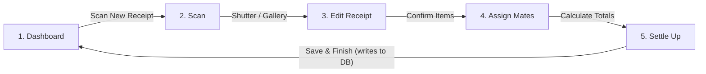
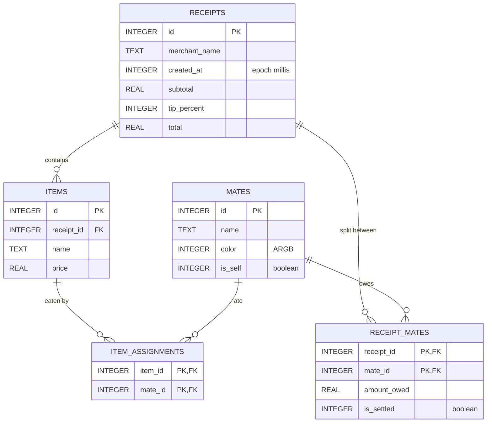

# CheckMate — Project Plan

CheckMate is a smart receipt-splitting app for students and friend groups: scan a receipt,
fix the items, say who had what, add a tip and see who owes what. This document covers the
architecture and how the project meets the **Lab 3** requirements.

---

## 1. Tech stack

| Concern | Choice | Why |
|---|---|---|
| Language | **Kotlin** | Official language for Android. |
| UI | **Jetpack Compose + Material 3** | Declarative UI, fast to prototype polished screens. |
| Navigation | **Navigation Compose** | One activity, 5 composable destinations, back stack handled for us. |
| Local DB | **Room** (on top of SQLite), annotation processing with **KSP** | Typed DAOs, compile-time checked SQL, `Flow` queries that refresh the UI automatically. |
| State | **ViewModel + StateFlow + coroutines** | Survives rotation; screens observe state and send events. |
| Build | Gradle Kotlin DSL, version catalog, **AGP 9.4** (built-in Kotlin), Gradle 9.6 | AGP 9.4 is the version that supports API 37. |
| SDK levels | `minSdk 35` (Android 15), `compileSdk 37`, `targetSdk 37` | Matches the lab target: API 37, runs on Android 15 or later. |

Camera note: the Scan screen is a **simulated viewfinder** (drawn in Compose) that returns a
mock scanned receipt. This keeps the lab focused on UI, navigation and the database, and works
on any emulator without camera permissions. Real OCR (CameraX + ML Kit) is listed as future work.

---

## 2. Screens & navigation flow

Every screen except the Dashboard has a back/close button. "Save & Finish" pops the back stack
to the Dashboard, whose list is a live Room query, so the new receipt appears immediately.

| # | Screen | Key interactions (`onClick`) |
|---|---|---|
| 1 | Dashboard | Scan card → Scan. Recent activity list is loaded from the DB. |
| 2 | Scan | Flash toggle, shutter → loads mock items → Edit, gallery → same, close → back. |
| 3 | Edit Receipt | Edit name/price, delete row, "+ Add missing item", "Confirm Items" (disabled while a row is invalid). |
| 4 | Assign Mates | Select a mate, tap a slot to assign, tap an avatar to unassign, "Split" assigns everyone, "Add mate" (saved to DB), "Calculate Totals". |
| 5 | Settle Up | Tip segmented control (0/10/15/20 %), WhatsApp share intent, bank icon marks settled, "Save & Finish" persists everything. |

State for the receipt being split lives in one `SplitViewModel` shared by screens 2–5.

---

## 3. Database design

### ER diagram

### Tables

- **receipts** — one row per split bill. `subtotal` is the sum of items, `total` includes the tip.
- **items** — line items of a receipt. `ON DELETE CASCADE` from `receipts`.
- **mates** — people you split with. `is_self` marks "You". Colors are stored so avatars stay consistent.
- **item_assignments** — many-to-many *items ↔ mates*. A shared ("split") item has several rows
  and its price is divided equally between them.
- **receipt_mates** — many-to-many *receipts ↔ mates* holding each person's computed share
  (`amount_owed`, tip included) and whether they've settled up.

Indices are created on every foreign key column. Room exports the schema JSON to
`app/schemas/` on each build, which documents the implemented schema.

### Data access (DAOs)

- `ReceiptDao.observeRecent(): Flow<List<ReceiptWithDetails>>` — Dashboard list (receipt + items + mates via the `receipt_mates` junction).
- `ReceiptDao.saveFullReceipt(...)` — one `@Transaction` that inserts the receipt, its items, the item assignments and each mate's share.
- `MateDao.observeAll()`, `MateDao.insert()` — mates row on the Assign screen, "Add mate".
- Seeding: on first launch the repository inserts You / Maria / John and two past receipts so the Dashboard isn't empty.

---

## 4. Split algorithm

All maths is done in integer **cents** to avoid floating-point errors (`domain/SplitCalculator.kt`):

1. For each item, divide its price between the mates assigned to it. Leftover cents go one each to
   the first mates (by id), so shares always add up exactly to the item price.
2. Tip is proportional: each mate's tip = their subtotal × tip %. People who ordered more tip more.
3. Total bill shown on Settle Up = sum of all shares.

Covered by `SplitCalculatorTest` (JUnit).

---

## 5. Build steps

1. Gradle scaffolding (version catalog, AGP 9.4, compileSdk/targetSdk 37, minSdk 35), manifest, theme.
2. Room entities, relations, DAOs, `AppDatabase`, repository with first-launch seeding.
3. `SplitCalculator` + unit test.
4. ViewModels (`DashboardViewModel`, `SplitViewModel`).
5. Shared UI components (avatars, avatar stack, sticky bottom button, top bar).
6. The 5 screens + `NavHost`.
7. Wire "Save & Finish" to the DB transaction; Dashboard observes the `Flow`.
8. Verify on an API 37 emulator, inspect tables with Android Studio's **Database Inspector**.

---

## 6. Lab 3 requirement checklist

| Requirement | Where it is fulfilled |
|---|---|
| GUI: 3–5 functional screens | `ui/screens/` — Dashboard, Scan, EditReceipt, AssignMates, SettleUp (5) |
| Interactive UI, `onClick` events, navigation | Every button/slot/chip in the screens; `ui/navigation/CheckMateNavHost.kt` |
| Local database | Room/SQLite — `data/db/AppDatabase.kt` (`checkmate.db`) |
| Data persistence (save + load) | Save: `SettleUpScreen` → `SplitViewModel.save()` → `ReceiptDao.saveFullReceipt()`. Load: `DashboardScreen` ← `ReceiptDao.observeRecent()`; mates loaded on Assign screen. Data survives app restarts. |
| DB design & implementation | Section 3 above + `data/db/entities/`, `data/db/dao/`, exported schema in `app/schemas/` |

## 7. Future work

- Real camera + OCR (CameraX, ML Kit Text Recognition).
- Receipt detail screen from the Dashboard, editing past splits.
- Multi-currency, payment links (Revolut/IBAN).
